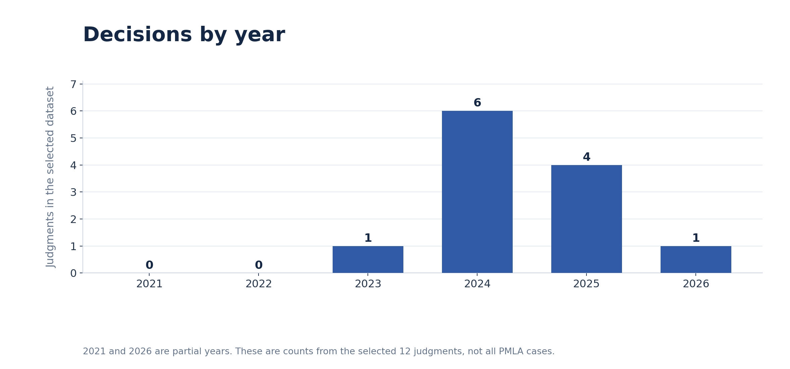
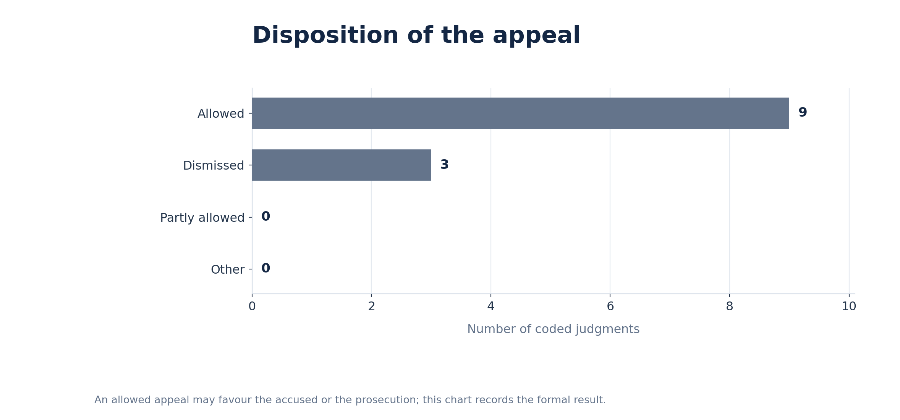
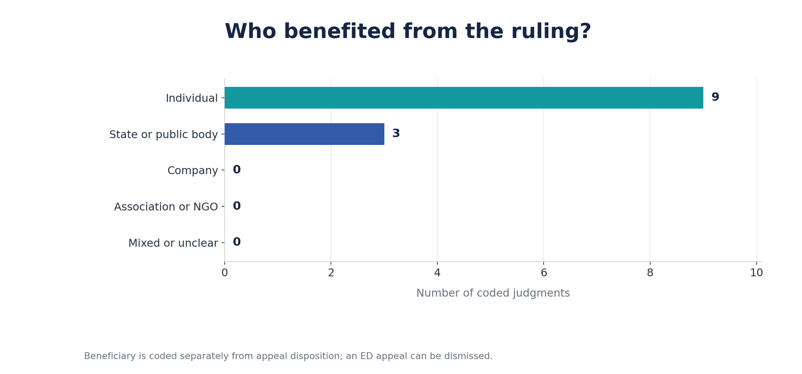

# PMLA bail and constitutional liberty in the Supreme Court of India, 2021–2026

**GitHub repository:** https://github.com/swastisharmaa04-coder/pmla-bail-judgments

## Team
- **Swasti Sharma** — Section D
- **Ishtartha H. R.** — Section D
- **Palak Manik** — Section D

## Topic
This project examines twelve selected, reasoned Supreme Court of India decisions on bail under the Prevention of Money-Laundering Act, 2002 (PMLA) and closely associated custody safeguards. Section 45 imposes demanding bail conditions, while Articles 21 and 22 of the Constitution protect liberty and lawful detention. We examine how statutory standards interact with procedural fairness, evidentiary assessment and the realistic prospect of a timely trial.

The assignment period is **1 September 2021 to 31 August 2026**. Our corpus contains **12 selected judgments**, decided between October 2023 and January 2026. **It is not a complete census** of all qualifying Supreme Court decisions during the five-year period. The findings are limited to these twelve cases.

## How we found the judgments
Discovery used searches for **“PMLA Section 45 bail”**, **“money laundering bail Article 21”**, **“Supreme Court Directorate of Enforcement bail”**, and individual case names in official Supreme Court results, supplemented by general web/legal search for identifying possible decisions. The original discovery searches did not preserve a reliable total results count; none is invented here. The selected sample covers decisions on the Section 45 test, the proviso for women, arrest/appearance safeguards and prolonged pretrial detention. We did not code routine, unreasoned notices or duplicate connected appeals as separate judgments.

The dataset records **one row per judgment**, even where the judgment disposes of several connected appeals. Each entry has the judgment's official Supreme Court PDF URL. The formal outcome (“Allowed” or “Dismissed”) is coded separately from the party benefiting from the decision. The Excel file retains the prescribed fictitious worked example in row 5, which is excluded from the CSV, webpage and charts; actual entries begin in row 6. Team-member assignments are recorded in the workbook's **Coded by** column.

## What the data shows

### Chart 1 — Decisions by year

There is **one** selected judgment in 2023, **six** in 2024, **four** in 2025 and **one** in early 2026; none of the selected rows is dated 2021 or 2022. A notable feature is the concentration in 2024, when the chosen decisions addressed court appearance, a statutory exception for women, evidence at the bail stage and prolonged detention. These are sample counts, **not the Supreme Court's total annual PMLA bail workload**. The first and last calendar years also fall only partly within the project window.

### Chart 2 — Formal appeal dispositions

**Nine** appeals are coded “Allowed” and **three** “Dismissed”. A formal appeal result does not mean the same thing as granting or refusing an accused person's bail. For example, the ED's appeal in *Kanhaiya Prasad* was allowed, and its appeal in *Subhash Sharma* was dismissed. *Tarsem Lal* allowed the appeals but resolved the warrant-and-summons problem without requiring an ordinary grant of anticipatory bail. The figures therefore call for doctrinal interpretation rather than an unqualified “bail success” percentage.

### Chart 3 — Practical beneficiary

**Nine** judgments are coded as favouring individuals and **three** as favouring the State or a public body. The contrast with Chart 2 shows why beneficiary must be a separate field. Different routes to liberty appear: factual satisfaction of Section 45 in *Prem Prakash*, the first proviso to Section 45 in *Kalvakuntla Kavitha*, invalid detention in *Subhash Sharma*, and Article 21 concerns about delayed trials in *V. Senthil Balaji* and later judgments. None of these rulings constitutes an acquittal.

## Limits
The twelve-case selection cannot establish a Court-wide grant rate, a complete doctrinal history or the total number of eligible judgments in the five-year period. Connected proceedings, case-specific facts and the distinction between a reasoned order and a reasoned judgment complicate comparisons. The HTML page provides additional case-specific analysis and links to primary judicial text; readers should consult the operative reasoning before generalising.

## AI-use disclosure
**OpenAI ChatGPT** assisted with case discovery, proposed summaries and category coding, checking legal details against accessible official Supreme Court judgments, generating the spreadsheet-aligned CSV and three charts, and drafting the HTML webpage and README. The recorded legal sources are **official Supreme Court documents**, not AI output or commercial headnotes. The team-member assignments in the workbook are preserved from the provided file; the team remains responsible for the independent reading and accuracy of its submission.
